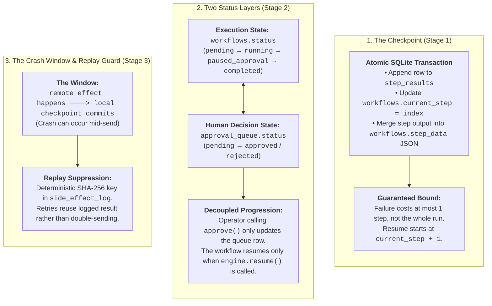
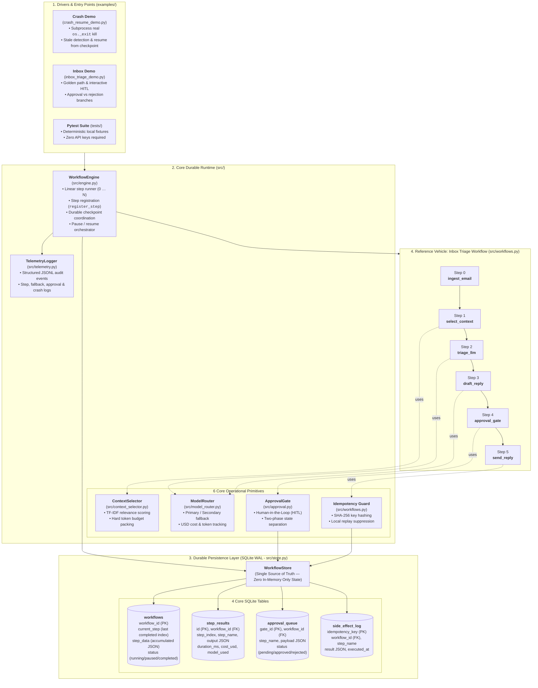
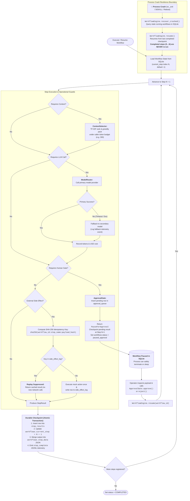

# DurableFlow Core: Architecture & Mental Model

> **The Throughline:** Most agent demos optimize for *intelligence* (prompts, tool calling, reasoning loops). **DurableFlow** is an educational lab and reference runtime that optimizes for *survivability and inspectability* — the operational mechanics needed to ensure multi-step LLM workflows survive process crashes, model outages, context window limits, human approval pauses, and duplicate side effects.
>
> *(Based on the architectural throughline in [walkthrough.md](walkthrough.md) and the staged curriculum in [learning-path.md](learning-path.md). This document covers **the core runtime** in `src/`, excluding extensions like Colony, Readiness, Context lineage, or Planner.)*

---

## 1. The Core Spine: 3 Invariants

Everything in the DurableFlow core hangs off three load-bearing operational invariants:

---

## 2. High-Level Core Architecture

The core runtime sits between user/driver code and durable SQLite storage:

---

## 3. Step Execution & Survivability Lifecycle

The runtime processes registered steps sequentially. If a step pauses for approval or if the process dies mid-execution, state is preserved in SQLite:

---

## 4. Following One Run: State Evolution

Tracing an action-required email through the 6-step reference workflow (`InboxTriageWorkflow`):

| Moment | `current_step` | Workflow Status | SQLite Durable Evidence | What Happens Next |
|---|:---:|---|---|---|
| **Created** | `-1` | `pending` | Initial input in `step_data` JSON | `execute()` marks it `running` |
| **Steps 0–3 Finished** (`ingest_email` → `draft_reply`) | `3` | `running` | 4 rows in `step_results`; outputs in `step_data` | Step 4 (`approval_gate`) runs |
| **Approval Requested** | `4` | `paused_approval` | Pending gate in `approval_queue`; **1st result at step 4** (`pending: true`) | Engine returns; process may exit |
| **Operator Approves** | `4` | `paused_approval` | `approval_queue.status = approved` (with actor/time) | `resume()` reads the queue decision |
| **Engine Resumes** | `4` | `approved → running` | **2nd result at step 4** (`approved: true`); updates `step_data` | Step 5 (`send_reply`) runs |
| **Mock Send Finished** | `5` | `completed` | Row in `side_effect_log`; send result checkpointed | Emits `workflow_complete` telemetry |

> [!NOTE]
> **Why Step Index 4 Appears Twice in `step_results`:**
> A pause is itself a durable event. Step index `4` records the pause when approval is requested, and appends the decided result when approved. `current_step` ends at `5` because all 6 steps (0 through 5) completed.

---

## 5. The 5 Questions Every Reviewer Can Answer

1. **What failure is DurableFlow designed to survive?**
   Process crashes (`os._exit`), transient model timeouts/5xx, context window overflows, operator delays during approval, and duplicate side effects on restart.
2. **What exactly is persisted after each step, and where?**
   Every completed step commits an atomic transaction: appends a row to `step_results`, updates `workflows.current_step`, merges output into `workflows.step_data` JSON, and logs JSONL telemetry.
3. **How do approval and side-effect state differ from execution state?**
   `workflows.status` tracks linear engine execution; `approval_queue.status` tracks operator decisions; `side_effect_log` tracks external idempotency keys. They move independently.
4. **Why is inbox triage the reference workflow rather than the product?**
   It exercises every operational primitive in one linear path (retrieval, model routing, human gate, side-effect). It is the reference vehicle, not the product.
5. **If a crash happens mid-step, what is lost?**
   Only the in-progress step is lost. All previous steps are frozen in SQLite and will never be re-executed when `resume()` is called.

---

## Related Documentation

- [Learning Path](learning-path.md) — The 9-stage curriculum to master the repo in dependency order.
- [Walkthrough & Index](walkthrough.md) — Comprehensive repository walkthrough and spec catalog.
- [Architecture Details](dflow-arch.md) — Subsystem diagrams, state machines, and invariants.
- [Agentic Loop](agent-loop.md) — How reason-act-observe loops bridge into `WorkflowEngine`.
- [Exercises](exercises.md) — Guided tasks for inspecting SQLite and testing fallback.
