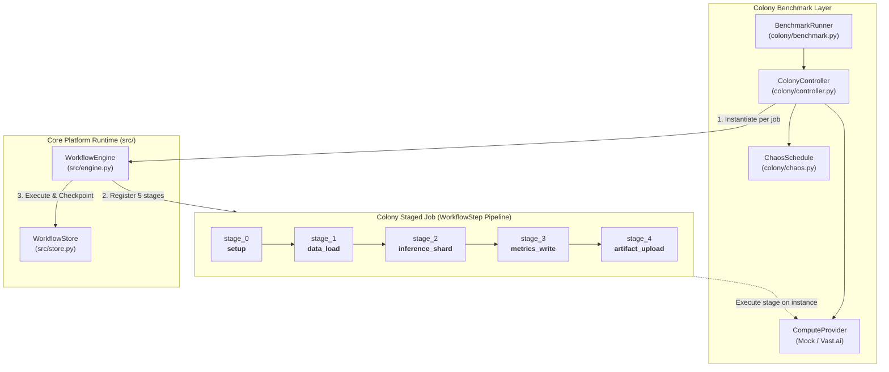

# Proposal: Refactor Colony to Compose Directly with WorkflowEngine

**Status:** PROPOSAL  
**Created:** 2026-08-20  
**Audience:** DurableFlow core maintainers, platform architecture reviewers  
**Package:** `colony/` (controller, store extension, runner), `src/` (engine, store)  
**Depends on:** `colony/colony-spec.md`, `docs/colony-methodology.md`, `src/engine.py`, `src/store.py`  
**Delta Classification:** Supporting / Architectural Convergence  
**Primary Goal:** Eliminate duplicate execution loops, parallel job tables, and ad-hoc simulation side-effect logging in `colony/` by refactoring Colony jobs to execute directly on `WorkflowEngine`.

---

## 1. Executive Summary & Problem Diagnosis

### 1.1 The Architectural Anomaly

DurableFlow's central platform thesis is that all long-running, multi-step work should execute as registered steps on the linear [`WorkflowEngine`](file:///Users/marcos/Downloads/playground/fde/durableflow/src/engine.py), checkpointing atomic state into [`WorkflowStore`](file:///Users/marcos/Downloads/playground/fde/durableflow/src/store.py) after every unit of progress. 

Every major subsystem in the repository adheres to this pattern:
- **Inbox Triage** ([`src/workflows.py`](file:///Users/marcos/Downloads/playground/fde/durableflow/src/workflows.py)) registers 6 macro steps on `WorkflowEngine`.
- **Reason-Act-Observe Agent** ([`agent/runner.py`](file:///Users/marcos/Downloads/playground/fde/durableflow/agent/runner.py)) registers each reasoning/tool turn as a step on `WorkflowEngine`.
- **CLEAR Software Factory** ([`factory/clear_workflow.py`](file:///Users/marcos/Downloads/playground/fde/durableflow/factory/clear_workflow.py)) registers 8 macro phases on `WorkflowEngine`.

In contrast, **Colony** ([`colony/`](file:///Users/marcos/Downloads/playground/fde/durableflow/colony/README.md)) bypassed `WorkflowEngine` and built a parallel, bespoke execution and persistence layer:

```text
CURRENT ARCHITECTURE (DUAL LOOPS & SHADOW PERSISTENCE):

  Workflow Engine Path (Standard):
  [Driver] ───► WorkflowEngine.execute() / resume()
                      │
                      ▼
               WorkflowStore (workflows, step_results, approval_queue)

  Colony Path (Bespoke / Divergent):
  [Benchmark] ──► ColonyController._run_job_stagewise()  <--- Custom while loop!
                        │
                        ▼
                  ColonyStore (colony_jobs, colony_runs) <--- Shadow tables!
                        │ (calls save_checkpoint manually)
                        ▼
                  WorkflowStore (workflows, step_results, side_effect_log)
```

### 1.2 Identified Technical Debt & Anti-Patterns in Colony

1. **Reinvented Stage-Execution Loop:**  
   [`ColonyController._run_job_stagewise()`](file:///Users/marcos/Downloads/playground/fde/durableflow/colony/controller.py#L77-L125) implements a manual `while job.current_stage + 1 < job.stage_count:` loop in Python. It manually checks stage progression, invokes provider stages, calculates durations, catches chaos interruptions, updates status, and manually invokes [`ColonyStore.checkpoint_job()`](file:///Users/marcos/Downloads/playground/fde/durableflow/colony/store_ext.py#L84-L96).
2. **Shadow State Machine in `colony_jobs`:**  
   [`ColonyStore`](file:///Users/marcos/Downloads/playground/fde/durableflow/colony/store_ext.py) initializes a separate `colony_jobs` table that tracks `job_id`, `run_id`, `current_stage`, `status`, `assigned_instance_id`, and `attempts`. When a stage completes, `ColonyStore` performs a dual-write: once to `workflows`/`step_results` via `self.workflow_store.save_checkpoint()`, and again to `colony_jobs` via `self.save_job()`.
3. **Simulation Side-Effect Hack (`dispatch_once`):**  
   [`ColonyStore.dispatch_once()`](file:///Users/marcos/Downloads/playground/fde/durableflow/colony/store_ext.py#L108-L127) writes synthetic keys (`f"{run_id}:{job_id}:dispatch:{stage}"`) into `side_effect_log` solely to prevent simulated stages from double-counting across benchmark replays. As noted in commit `323b9ee`, this is non-production simulation bookkeeping polluting the platform's side-effect boundary.
4. **Bespoke Recovery Flow:**  
   When an instance is lost during chaos injection, `ColonyController` catches the event in its private loop, marks `job.status = JobStatus.RECOVERING`, acquires a new instance slot, and continues the `while` loop. It does not use the engine's canonical `recover_crashed()` or `resume()` recovery lifecycles.

---

## 2. Proposed Target Architecture

The proposed refactor eliminates `colony_jobs` dual-writes and the custom `_run_job_stagewise()` loop. Instead, Colony defines a parameterized **`ColonyJobWorkflow`** executed directly by [`WorkflowEngine`](file:///Users/marcos/Downloads/playground/fde/durableflow/src/engine.py).



### 2.1 Core Architectural Principles of the Refactor

1. **Job Stages are `WorkflowStep` Callables:**  
   The 5 stages of a Colony job (`setup`, `data_load`, `inference_shard`, `metrics_write`, `artifact_upload`) are registered as standard `(name, fn)` steps on `WorkflowEngine`.
2. **Instance Context Injected via `dependencies`:**  
   The active `Instance`, `ComputeProvider`, and `CostAccountant` are passed to `WorkflowEngine(dependencies={...})`. Step functions access the allocated instance via `dependencies["current_instance"]`.
3. **Chaos-Induced Eviction as Process Loss / Engine Interruption:**  
   When `ChaosSchedule` triggers an eviction during stage execution:
   - The provider/instance terminates.
   - The stage raises an `InstanceTerminatedError` (or simulated crash).
   - `WorkflowEngine` marks the workflow step interrupted.
   - `ColonyController` allocates a new instance, updates `dependencies["current_instance"]`, and calls `engine.resume(workflow_id)`.
   - `WorkflowEngine.resume()` automatically starts at `current_stage + 1`, guaranteeing zero redundant work.
4. **Retirement of `colony_jobs` Table:**  
   Job metadata, stage indexes, attempt counts, and outputs live exclusively in `workflows` and `step_results`. `colony_runs` is retained only as an aggregate benchmark report sink.

---

## 3. Detailed Component Refactoring Specification

### 3.1 New Module: `colony/workflow.py`

Create a standardized workflow builder for Colony jobs:

```python
"""Colony 5-stage compute job as a standard WorkflowEngine pipeline."""

from __future__ import annotations

from typing import Any
from src.engine import WorkflowEngine, WorkflowStep
from src.store import StepResult, WorkflowState, WorkflowStore
from .models import Job


def make_colony_stage_step(stage_index: int, stage_name: str):
    def stage_step(
        state: WorkflowState,
        step_data: dict[str, Any],
        dependencies: dict[str, Any],
    ) -> StepResult:
        provider = dependencies["compute_provider"]
        instance = dependencies["current_instance"]
        cost_accountant = dependencies["cost_accountant"]
        job_spec = state.step_data.get("spec", {})
        
        # Execute stage through provider
        result = provider.run_stage(instance, state.step_data, stage_index)
        cost_accountant.charge(instance, result.duration_s)
        
        return StepResult(
            step_name=stage_name,
            output={
                "stage": stage_index,
                "stage_name": stage_name,
                "output": result.output,
                "instance_id": instance.instance_id,
            },
            duration_ms=result.duration_s * 1000.0,
        )

    return WorkflowStep(name=stage_name, fn=stage_step)


def build_colony_job_engine(
    store: WorkflowStore,
    dependencies: dict[str, Any],
    stage_names: list[str] | None = None,
) -> WorkflowEngine:
    engine = WorkflowEngine(store=store, dependencies=dependencies)
    stages = stage_names or [
        "setup",
        "data_load",
        "inference_shard",
        "metrics_write",
        "artifact_upload",
    ]
    for idx, name in enumerate(stages):
        engine.register_step(name, make_colony_stage_step(idx, name).fn)
    return engine
```

### 3.2 Refactored `ColonyController` (`colony/controller.py`)

Simplify `ColonyController` from a custom loop runner into a pool and scheduler coordinator:

```python
class ColonyController:
    def __init__(
        self,
        provider: ComputeProvider,
        schedule: ChaosSchedule,
        *,
        pool_size: int = 5,
        db_path: str | Path | None = None,
    ):
        self.provider = provider
        self.schedule = schedule
        self.pool_size = pool_size
        self.store = WorkflowStore(db_path or Path(tempfile.gettempdir()) / "colony.sqlite")
        self.cost = CostAccountant()

    def run_job(self, run_id: str, job: Job, slot: int, report: RunReport) -> bool:
        workflow_id = f"{run_id}:{job.job_id}"
        instance = self.provider.acquire(slot=slot, now=report.wall_clock_seconds)
        
        # Initialize standard workflow
        self.store.create_workflow(
            workflow_type="colony_job",
            workflow_id=workflow_id,
            initial_data={"batch_id": job.batch_id, "spec": job.spec},
        )

        dependencies = {
            "compute_provider": self.provider,
            "current_instance": instance,
            "cost_accountant": self.cost,
            "chaos_schedule": self.schedule,
        }
        engine = build_colony_job_engine(self.store, dependencies)

        # Execute using standard engine lifecycle
        state = engine.execute(workflow_id)
        while state.status != WorkflowStatus.COMPLETED:
            if report.total_cost_usd >= report.budget_usd:
                report.budget_halted = True
                return False
            
            # Chaos or failure handling: acquire replacement instance and resume
            report.instances_lost += 1
            report.recoveries += 1
            new_instance = self.provider.acquire(slot=slot, now=report.wall_clock_seconds)
            dependencies["current_instance"] = new_instance
            state = engine.resume(workflow_id)

        report.jobs_completed += 1
        return True
```

### 3.3 Retirement Plan for `ColonyStore` (`colony/store_ext.py`)

1. **Delete `colony_jobs` table:**  
   Inspect job state via `WorkflowStore.load_workflow(workflow_id)` and `WorkflowStore.get_step_results(workflow_id)`.
2. **Migrate `colony_runs` to a lightweight `ColonyReportStore`:**  
   Keep `save_report()` and `load_report()` in a dedicated 20-line reporter module (`colony/report_store.py`) or persist benchmark summary JSONs to disk directly.
3. **Remove `dispatch_once`:**  
   Because `WorkflowEngine.resume()` guarantees that completed steps are skipped and never re-executed, artificial `dispatch_once` checks in `side_effect_log` become redundant and can be safely deleted.

---

## 4. Architectural Comparison: Before vs. After

| Dimension | Before (Current Implementation) | After (Refactored Implementation) |
|---|---|---|
| **Execution Engine** | Custom `while` loop in `ColonyController` | Standard [`WorkflowEngine`](file:///Users/marcos/Downloads/playground/fde/durableflow/src/engine.py) |
| **Storage Tables** | 2 parallel tables (`colony_jobs`, `colony_runs`) + `workflows` | Standard `workflows` & `step_results` (+ report table) |
| **Step Durability** | Manual `ColonyStore.checkpoint_job()` calls | Automatic atomic checkpoints in `WorkflowEngine` |
| **Crash Recovery** | Custom recovery loop in controller | Canonical `engine.resume()` starting at `current_step + 1` |
| **Replay Suppression** | Fake simulation entries in `side_effect_log` | Native monotonic index progression in `WorkflowEngine` |
| **Code Redundancy** | ~250 lines of duplicate state & loop logic | ~60 lines of standard step definitions |
| **Extensibility** | Closed to other workflow tools | Seamlessly inspectable via Context Ledger, Eval Gate, and CLI |

---

## 5. Migration & Verification Plan

### 5.1 Test Suite & Verification Matrix

The refactoring must preserve identical benchmark scoreboards under existing seeds:

| Test Target | Verification Command | Pass Criteria |
|---|---|---|
| **Unit Conformance** | `pytest tests/test_benchmark.py -v` | All mock benchmark runs pass with identical outputs. |
| **Chaos Identity** | `pytest tests/test_chaos_identity.py -v` | Seeded chaos schedules produce identical loss offsets. |
| **Recovery Invariant** | `pytest tests/test_colony_recovery.py -v` | Completed stages are never re-run after simulated instance loss. |
| **Cost Parity** | `pytest tests/test_cost.py -v` | Cost calculations match naive vs. durable delta benchmarks. |
| **End-to-End Demo** | `python examples/chaos_benchmark_demo.py` | Produces identical `+10 pts` completion delta at `$0.23` cost under seed `1337`. |

### 5.2 Phased Rollout Sequence

- **Phase 1:** Implement `colony/workflow.py` with `make_colony_stage_step()` and unit tests.
- **Phase 2:** Refactor `ColonyController` to delegate job execution to `WorkflowEngine`.
- **Phase 3:** Deprecate `ColonyStore` table `colony_jobs` and remove `dispatch_once`.
- **Phase 4:** Verify all existing tests in `tests/test_colony_*.py` and update documentation in `colony/README.md` and `docs/colony-methodology.md`.

---

## 6. Decision & Recommendation

**Recommendation:** **Approve and implement.**  
Refactoring Colony to use `WorkflowEngine` directly eliminates the repository's primary architectural counterexample, reduces codebase surface area by ~200 lines of duplicative state-management code, and proves that `WorkflowEngine` is robust enough to power distributed spot-compute simulations as easily as linear assistant workflows.
